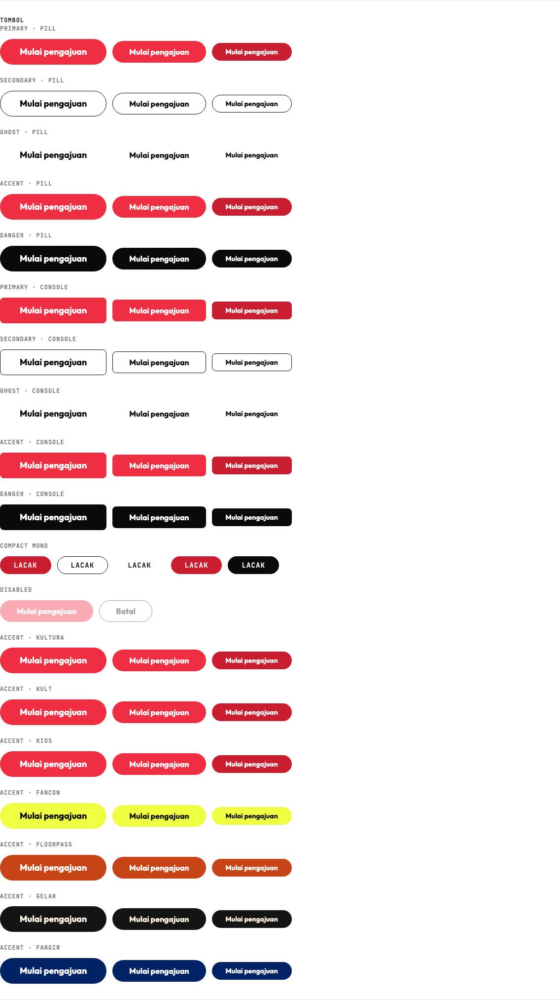

# @kultura/house-kit

One small shared package that gives every Kultura Digital site the same colours, type, buttons, footer, motion rules, performance check and one card/slab viewer. It replaces nothing on its own; each product adopts it in its own PR.

Plan of record: `04_Digital/00_Strategy/Kultura_Digital_Web_Design_Benchmark_v2_2026-10-31.md` (sections 5 and 7, decisions DS-1, DS-2, DS-4, DS-5).

## Install

```json
"@kultura/house-kit": "github:adesulco/kultura-house-kit#v0.1.0"
```

`dist/` is committed, so installing from the tag needs no build step. The repository is public (decided 31 Oct 2026), so CI and Vercel install it with no token.

Repos that cannot install from GitHub (the grade.kioskultura.com family on GitLab) vendor `kultura-house-kit.css` and `kultura-house-kit.js` from the GitHub release. See `docs/adoption-kioskultura.md`.

## Exports

| Import | What it is |
|---|---|
| `@kultura/house-kit/tokens.css` | CSS custom properties only, plus the product presets |
| `@kultura/house-kit/base.css` | tokens + type scale + buttons + focus + motion + footer strip + card viewer |
| `@kultura/house-kit/footer.css` | footer strip and motion rules only, self-scoped, no global tokens (FanHub, DS-2) |
| `@kultura/house-kit/motion.css` | `.k-reveal` and `.k-lift` only |
| `@kultura/house-kit/tailwind` | Tailwind preset mapping the same tokens (`theme.extend`) |
| `@kultura/house-kit/elements` | registers `<k-card-viewer>` and `<k-footer-strip>`, starts `.k-reveal` |
| `@kultura/house-kit/react` | `<CardViewer>`, `<FooterStrip>`, `<Button>` |
| `@kultura/house-kit/ecosystem.json` | the footer links, one source |
| `@kultura/house-kit` | tokens and presets as JS, contrast helpers, `buttonClass()`, footer renderers |

## Set the product

Put the product key on `<html>`. It sets `--k-accent` and `--k-on-accent`.

```html
<html lang="id" data-k-product="kultura">
```

| Product | `--k-accent` | `--k-on-accent` | Notes |
|---|---|---|---|
| `kultura`, `kult`, `kios` (default) | `#EE2F42` | `#FFFFFF` | Fills and type 24 px and up. Text below 16 px sits on red-700 `#C81E2F` |
| `fancon` | `#EFFF42` | `#0A0A0A` | FanCon lime, used on ink surfaces |
| `floorpass` | `#C74416` | `#FFFFFF` | 4.9:1. `#E8632B` is retired (3.4:1) |
| `gelar` | `#141414` | `#FFF4E1` | |
| `fangir` | `#002366` | `#FFFFFF` | |
| `fanhub` | not set | | FanHub keeps its own tokens (DS-2) |

A unit test computes WCAG contrast for every preset and fails under 4.5:1.

## Tokens

| Token | Value | Use |
|---|---|---|
| `--k-red-500` | `#EE2F42` | Fills, type 24 px and up, logo, ecosystem strip |
| `--k-red-700` | `#C81E2F` | Links, small buttons, text-size red (5.7:1 on white). The PSA site's `#C81E30` maps here |
| `--k-red-800` | `#B0182A` | Pressed state, focus ring |
| `--k-ink` / `--k-paper` | `#0A0A0A` / `#FFFFFF` | |
| `--k-surface` / `--k-line` / `--k-muted` | `#F4F4F4` / `#E6E6E6` / `#6E6E76` | |
| `--k-amber-text` / `-tint` / `-line` | `#8A5A00` / `#FFF4DE` / `#F2DCA8` | Warnings. Never red for form errors |
| `--k-green` / `--k-green-tint` | `#0F7A3D` / `#E9F8EF` | Success |
| `--k-font` / `--k-mono` | Outfit / JetBrains Mono | |
| `--k-radius-pill` / `-console` / `-card` | `9999px` / `8px` / `12px` | Pill for consumer sites, 8 px for consoles |
| `--k-fast` / `--k-base` / `--k-slow` | `120ms` / `200ms` / `320ms` | Easing `--k-ease: cubic-bezier(.2,.7,.2,1)` |

## Type scale

Classes `.k-display .k-h1 .k-h2 .k-h3 .k-body .k-small .k-label`. Desktop from 640 px.

| Class | Desktop / mobile | Line height | Weight |
|---|---|---|---|
| `.k-display` | 96 / 48 | 0.95 | 800 |
| `.k-h1` | 64 / 40 | 1.02 | 800 |
| `.k-h2` | 44 / 32 | 1.05 | 700 |
| `.k-h3` | 28 / 22 | 1.15 | 700 |
| `.k-body` | 17 / 16 | 1.5 | 400 |
| `.k-small` | 14 | 1.45 | 400 |
| `.k-label` | 12 mono caps, tracking .08em | 1.4 | 500 |

Tracking -0.02em on everything 40 px and up. Nothing a user must read goes below 14 px; 12 px is for mono caps labels only.

**Fonts.** Outfit 400/500/700/800, Latin subset, `font-display: swap`, self-hosted through the framework's font loader. In Next:

```ts
import { Outfit, JetBrains_Mono } from "next/font/google";
const outfit = Outfit({ subsets: ["latin"], weight: ["400", "500", "700", "800"], display: "swap", variable: "--k-font-outfit" });
const mono = JetBrains_Mono({ subsets: ["latin"], weight: ["500"], display: "swap", variable: "--k-font-mono" });
// then in CSS: :root { --k-font: var(--k-font-outfit), system-ui, sans-serif; --k-mono: var(--k-font-mono), ui-monospace, monospace; }
```

## Buttons

`.k-btn` + size (`--hero` 52/18, default 44/16, `--compact` 36/14) + variant (`--primary`, `--secondary`, `--ghost`, `--accent`, `--danger`) + shape (`--pill` default, `--console` 8 px). `--mono` gives mono caps and only works with `--compact`. Icon goes in `<span class="k-btn__icon">` after the label.



Generated from `examples/` with `pnpm matrix`. Computed styles for every combination are snapshot-tested.

```tsx
import { Button } from "@kultura/house-kit/react";
<Button size="hero" variant="primary" href="/submit">Mulai pengajuan</Button>
```

## Footer strip

```tsx
import { FooterStrip } from "@kultura/house-kit/react";
<FooterStrip current="kultura" entity="PT Kios Gemar Kreasi" lang="id" />
```

Renders plain HTML on the server, so nothing shifts. Outside React use `<k-footer-strip current="gelar" entity="PT Kultura Digital Kreasi, Jakarta">` with the elements script, or `renderFooterStripHTML()` on the server. The big product wordmark above the link columns stays in each product's footer; the kit provides `.k-footer-wordmark`.

## Card viewer

```tsx
import { CardViewer } from "@kultura/house-kit/react";
<CardViewer src="/c/front.webp" back="/c/back.webp" alt="JICAF 26 nomor 007" />
<CardViewer kind="slab" src="/s/slab.webp" alt="Slab PSA 10" label="PSA 10 · Gem mint" />
```

Attributes: `src`, `back` (tap, click, Enter or Space flips), `alt` (required), `kind="card|slab"`, `sheen="none|holo|foil"`, `max-tilt` (default 8), `eager`, `label` (slab). Pointer tilt on desktop; on phones the first tap turns on device orientation (iOS asks), with drag-to-tilt when refused. No WebGL, no dependencies, never upscales past the image's natural width. Without JS it is the front image.

## Motion

Only `transform` and `opacity` animate. `.k-reveal` (12 px rise and fade, once) and `.k-lift` (2 px hover lift). Both are off under `prefers-reduced-motion: reduce`. `.k-reveal` hides content only after the elements script runs, so pages without it never lose text.

## Do not

- No loaders or splash screens.
- No scroll hijacking, smooth-scroll libraries or "scroll to continue".
- No sound.
- No cursor replacement.
- No animation of anything other than `transform` and `opacity`.
- No red for form errors (amber for warnings, ink for validation text).
- No uppercase button text except compact mono.
- No body text under 14 px.
- No third-party script before interaction, except analytics.

## Performance budget and check

Budget: LCP at most 2.5 s and INP at most 200 ms on throttled 4G mobile; Lighthouse performance at least 85; hero image at most 200 KB (AVIF/WebP with a width `srcset`); public-page JS at most 150 KB gzipped; Outfit in two to four weights.

Product repos call the reusable workflow from their fast tier on PRs that touch public pages:

```yaml
  lighthouse:
    needs: changes
    if: needs.changes.outputs.public == 'true' && github.event_name == 'pull_request'
    permissions: { contents: read, deployments: read }
    uses: adesulco/kultura-house-kit/.github/workflows/lighthouse-mobile.yml@v0.1.0
    with:
      paths: |
        /
        /en
    secrets: inherit
```

It waits for the PR's preview deployment, runs Lighthouse (mobile preset, simulated 4G, median of three), fails under the budget and writes a table to the job summary. TBT stands in for INP in a lab run. Optional secret: `VERCEL_AUTOMATION_BYPASS_SECRET`, for protected previews. Locally:

```bash
node scripts/lighthouse-mobile.mjs https://kultura.co.id/ https://kultura.co.id/en
```

## Develop

```bash
pnpm install
pnpm lint && pnpm typecheck && pnpm test:unit
pnpm build          # dist/ is committed; CI fails if it is stale
pnpm test:e2e       # examples/ at 390 and 1280
node scripts/serve-examples.mjs   # http://localhost:4173/examples/
```

Rules: `docs/ENGINEERING_RULES.md`. CI follows `Kultura_CI_Standard_v1_2026-10-14.md`: `quick` on every push, `full` (browser tests) on ready PRs and main.
